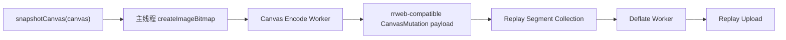
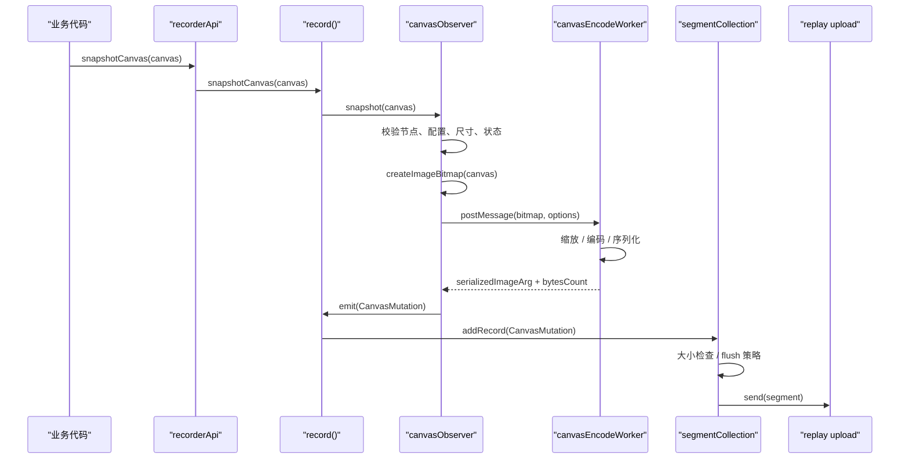

# Session Replay Canvas 设计文档

## 结论摘要

基于当前调查结果，这个项目的 canvas replay 设计应该优先兼容 `rrweb` 的 `CanvasMutation` 方案，而不是单独走“图片上传 API + frameId 引用”的旁路方案。

原因很直接：

- 我们播放器侧已经使用 `rrweb replayer`
- `rrweb replayer` 原生支持 `CanvasMutation` 回放
- `Sentry` 的 `replayCanvasIntegration` 实际也是建立在这套机制之上

因此本项目更合理的方向是：

- 录制端产出 rrweb 可消费的 `CanvasMutation`
- 播放端继续使用现有 rrweb replayer
- 第一阶段优先实现 snapshot-based canvas replay
- 不在第一阶段就做 full command capture 和 WebGL 自动录制

## 强制规则

本设计有一条强制规则：

- 绝对不能因为引入 canvas replay 而破坏当前已有的 replay 录制、segment、压缩、上传、回放逻辑

这不是建议，而是硬约束。

具体要求：

- `replayCanvasEnabled` 默认必须为 `false`
- 在未开启 canvas replay 时，现有 replay 行为必须与改动前完全一致
- 任何 canvas 相关异常都不能影响普通 replay event 的录制和发送
- 任何 canvas 编码失败、worker 失败、超限丢弃，都只能影响当前 canvas snapshot，不能扩散到 recorder 主链
- 不能修改现有普通 replay event 的语义、结构和 flush 行为，除非事件本身就是 `CanvasMutation`
- 不能让未使用 canvas replay 的用户承担额外明显的主线程、内存或网络开销

实现上要遵守：

- canvas 逻辑必须是增量接入，不是重写现有 replay 主链
- canvas 相关逻辑必须有清晰开关和隔离边界
- 默认路径必须继续是“无 canvas replay 的旧路径”

## 背景

当前 replay 主链在这些文件中：

- [packages/rum/src/boot/startRecording.js](/Users/dengchangliang/www/rum/browser-sdk/packages/rum/src/boot/startRecording.js)
- [packages/rum/src/boot/recorderApi.js](/Users/dengchangliang/www/rum/browser-sdk/packages/rum/src/boot/recorderApi.js)
- [packages/rum/src/domain/replay/record/record.js](/Users/dengchangliang/www/rum/browser-sdk/packages/rum/src/domain/replay/record/record.js)
- [packages/rum/src/domain/replay/record/observers.js](/Users/dengchangliang/www/rum/browser-sdk/packages/rum/src/domain/replay/record/observers.js)
- [packages/rum/src/domain/replay/segmentCollection/segmentCollection.js](/Users/dengchangliang/www/rum/browser-sdk/packages/rum/src/domain/replay/segmentCollection/segmentCollection.js)

当前项目和本次设计相关的两个事实：

- 录制端 replay 结构整体接近 rrweb 风格，但没有 canvas 录制
- 播放端已经使用 `rrweb replayer`

这意味着设计关键点不在“播放器怎么自己补一层画图”，而在“录制端如何产出 rrweb 能直接理解的 `CanvasMutation`”。

## 对 Sentry 实现的调查结论

### 1. Sentry integration 层

实际源码：

- `getsentry/sentry-javascript/packages/replay-canvas/src/canvas.ts`

它做的事情很明确：

- 打开 `recordCanvas: true`
- 注入 `getCanvasManager`
- 配置 `sampling.canvas`
- 配置 `dataURLOptions`
- 对外暴露 `snapshot(canvasElement?, options?)`

它的质量档位对应的是低频快照：

- `low`: `sampling.canvas = 1`
- `medium`: `sampling.canvas = 2`
- `high`: `sampling.canvas = 4`

所以 Sentry 的官方 canvas integration 默认并不是“记录所有 canvas API 调用”，而是“按频率采样快照”。

### 2. rrweb 底层实际支持两套模式

实际源码来自 `@sentry-internal/rrweb@2.40.0`：

- `src/record/observers/canvas/canvas-manager.ts`

底层逻辑：

- 当 `sampling === 'all'`
  - 安装 2D / WebGL mutation observer
  - 记录 canvas 命令
- 当 `sampling` 是数字，或开启 `enableManualSnapshot`
  - 走快照采集模式

因此，rrweb 底层能力其实有两种：

1. command-based
2. snapshot-based

而 Sentry 默认使用的是第二种。

### 3. Sentry 的快照不是外链图片

这次源码调查已经可以明确：

- rrweb 在快照模式下会对 canvas 调 `createImageBitmap(canvas)`
- 将结果发给 worker
- worker 再返回一条 `CanvasMutation`
- 这条 `CanvasMutation` 内部包含：
  - `clearRect`
  - `drawImage`
- `drawImage` 的参数里内嵌了序列化的位图数据

也就是说：

- Sentry 的快照是位图数据
- 但不是独立图片资源 URL
- 而是 replay event 中的序列化参数

### 4. 播放器如何处理

rrweb 回放侧源码：

- `src/replay/canvas/index.ts`
- `src/replay/canvas/deserialize-args.ts`

rrweb replayer 在播放到 `CanvasMutation` 时会：

1. 找到目标 canvas 节点
2. 反序列化参数
3. 调 canvas 2D 或 WebGL 对应 API
4. 把图像或命令真正 apply 到 canvas 上

因此，既然我们已经使用 rrweb replayer，最自然的路径就是让录制端也产出 rrweb 能直接消费的 `CanvasMutation`。

## 为什么当前项目应优先走 rrweb CanvasMutation 方案

### 1. 播放器已经具备消费能力

这点是决策分水岭。

如果播放器已经是 rrweb replayer，那么：

- 录制端只要产出 rrweb 兼容的 `CanvasMutation`
- 播放器端不需要重新设计一套 `frameId -> 拉图 -> drawImage` 的旁路逻辑

这比独立图片引用路线更统一。

### 2. seek、暂停、倍速都更自然

rrweb 的时间轴、事件队列、pause/play/seek 机制本来就是围绕 event replay 设计的。

canvas 也进入同一条事件链后：

- seek 不需要自己额外找最近帧
- 不需要另外维护图片缓存时序
- 不需要播放器自己管理“引用型 canvas 状态”

### 3. 协议更统一

当前 replay 的长期方向如果仍然是 rrweb 兼容，那么 canvas 也应当进入同一套协议。

否则会形成两套模型：

- 普通 replay：rrweb event
- canvas replay：外部资源引用

这种分裂短期可行，但长期会增加复杂度。

## 为什么第一阶段仍然不建议 full command capture

虽然我们应该走 rrweb `CanvasMutation` 路线，但不意味着第一版就该做到 rrweb 最重的那条路径。

### 1. full command capture 实现复杂度更高

它要求：

- hook 2D canvas API
- hook WebGL / WebGL2 API
- 序列化 typed arrays、ImageData、Blob、WebGL 对象引用
- 回放时精确反序列化并重建上下文状态

这套能力 rrweb 已经有，但我们当前项目的录制端并没有直接内置这一套。

### 2. WebGL 自动录制问题最多

Sentry 的源码也说明了这个现实：

- WebGL / WebGL2 在自动快照时要处理 `preserveDrawingBuffer`
- 否则可能拿到空白内容
- 甚至需要 `clear(COLOR_BUFFER_BIT)` 的 hack 才能让 `createImageBitmap` 拿到画面

因此 WebGL 应该后置。

### 3. 第一阶段目标应该是“和 rrweb 对齐”，不是“一次做满”

所以推荐的第一阶段目标是：

- 仍然输出 `CanvasMutation`
- 但先做 snapshot-based
- 先支持 manual snapshot
- 先支持 2D canvas

这样：

- 协议已经对齐 rrweb
- 播放器不用改模型
- 实现风险仍然可控

## 推荐方案

## 第一阶段方案

### 目标

- 录制端产出 rrweb 兼容 `CanvasMutation`
- 播放端直接由现有 rrweb replayer 回放
- 优先 manual snapshot
- 只支持 2D canvas
- 默认关闭

### 非目标

- 不做 WebGL / WebGL2 自动录制
- 不做 `sampling = 'all'` 命令录制
- 不做独立图片上传 API
- 不做非 rrweb 协议的 frame 引用方案

## 事件模型

当前 [packages/rum/src/types/sessionReplayConstants.js](/Users/dengchangliang/www/rum/browser-sdk/packages/rum/src/types/sessionReplayConstants.js) 中已经有注释掉的：

```js
// CanvasMutation : 9,
```

应当改为正式定义：

```js
IncrementalSource.CanvasMutation = 9
```

第一阶段建议直接复用 rrweb 的快照型 `CanvasMutation` 语义，即生成类似下面的结构：

```js
{
  type: RecordType.IncrementalSnapshot,
  timestamp,
  data: {
    source: IncrementalSource.CanvasMutation,
    id: canvasNodeId,
    type: '2D',
    commands: [
      {
        property: 'clearRect',
        args: [0, 0, width, height]
      },
      {
        property: 'drawImage',
        args: [
          serializedImageBitmap,
          0,
          0,
          width,
          height
        ]
      }
    ]
  }
}
```

这里的关键不是字段名完全照抄 Sentry，而是：

- 语义要与 rrweb replayer 兼容
- 让现有播放器无需额外协议分支

## 录制方式选择

### 推荐：manual snapshot

第一阶段推荐只做：

```js
DATAFLUX_RUM.snapshotCanvas(canvas)
```

或至少先在 recorder 内部提供：

```js
recorderApi.snapshotCanvas(canvas)
```

调用后流程：

1. 校验 replay recording 已启动
2. 校验节点是已序列化 canvas
3. 调用 `createImageBitmap(canvas)`
4. 将位图转成 rrweb 可序列化参数
5. emit 一条 `CanvasMutation`

### 暂不推荐：自动快照

自动快照在第一阶段不建议做，原因：

- 定时扫描 canvas 会增加复杂度
- 空白帧、重复帧、隐藏 canvas 等问题更多
- WebGL 下时机判断更难

### 暂不推荐：命令录制

`sampling = 'all'` 对应的是更完整的 rrweb canvas observer 路线，但第一阶段不建议直接上，原因：

- 实现更重
- 需要深度接管 2D / WebGL API
- 错误面更大

## 模块设计

### 1. Canvas Observer

新增文件：

- `packages/rum/src/domain/replay/record/canvasObserver.js`

职责：

- 暴露 `snapshot(canvas, options?)`
- 只处理 manual snapshot
- 校验 canvas 是否可录
- 将当前画面转成 rrweb 兼容 payload
- emit `CanvasMutation`

### 2. 图像序列化

建议新增辅助模块：

- `packages/rum/src/domain/replay/record/canvasSerializeArgs.js`

职责：

- 将 `ImageBitmap` / `Blob` / `ArrayBuffer` 转成 rrweb 可用参数
- 尽量与 rrweb/Sentry 当前序列化结构保持兼容

第一阶段建议优先支持：

- `ImageBitmap -> Blob -> ArrayBuffer(base64)`

### 3. Recorder 集成

需要修改：

- [packages/rum/src/domain/replay/record/record.js](/Users/dengchangliang/www/rum/browser-sdk/packages/rum/src/domain/replay/record/record.js)
- [packages/rum/src/domain/replay/record/index.js](/Users/dengchangliang/www/rum/browser-sdk/packages/rum/src/domain/replay/record/index.js)
- [packages/rum/src/boot/recorderApi.js](/Users/dengchangliang/www/rum/browser-sdk/packages/rum/src/boot/recorderApi.js)

职责：

- 在录制生命周期内创建 `canvasObserver`
- 将 `snapshotCanvas` 向上暴露
- 在 stop 时清理资源

### 4. 暂不新增独立图片上传链路

这版方案下，不建议第一阶段新增：

- `canvasSnapshotTransport`
- `canvasSnapshotQueue`
- `frameId`

因为这条路线已经不再是主方案。

## 配置设计

建议新增配置项：

```js
{
  replayCanvasEnabled: false,
  replayCanvasMode: 'manual',
  replayCanvasQuality: 0.4,
  replayCanvasMimeType: 'image/webp'
}
```

可选后续配置：

```js
{
  replayCanvasSampling: 2,
  replayCanvasMaxSize: 1280,
  replayCanvasEnableManualSnapshot: true
}
```

默认建议：

- `replayCanvasEnabled: false`
- `replayCanvasMode: 'manual'`

## Segment 大小限制设计

这是当前方案里必须单独处理的部分。

现有 replay segment 设计假设 event 是轻量结构：

- 普通 DOM snapshot
- mutation
- input
- scroll
- mouse interaction

而 canvas snapshot event 即使走 rrweb `CanvasMutation`，其内部也可能携带较重的位图数据。

当前限制位于：

- [packages/rum/src/domain/replay/segmentCollection/segmentCollection.js](/Users/dengchangliang/www/rum/browser-sdk/packages/rum/src/domain/replay/segmentCollection/segmentCollection.js)

当前常量：

- `SEGMENT_BYTES_LIMIT = 60000`

这个限制对 canvas event 不够安全，原因：

- 一条编码后的 canvas snapshot event 可能接近一个 segment 上限
- base64 或序列化包装会继续增大体积
- 若与普通 mutation 混在同一个 segment，segment flush 频率会显著升高

### 设计原则

- canvas event 必须被视为“重事件”
- 不能按普通 replay event 同权处理
- 不能允许任意大 canvas payload 直接进入 segment

### 建议策略

第一阶段建议增加三层保护：

1. 单帧编码体积限制

- 新增配置：`replayCanvasMaxEncodedBytes`
- 例如默认 `30 KB` 或 `40 KB`
- 编码结果超限时：
  - 先尝试降质量
  - 再尝试缩小尺寸
  - 仍超限则丢弃

2. canvas event 单独 flush 策略

- 新增配置：`replayCanvasFlushImmediately`
- 推荐默认开启
- 一旦成功加入 `CanvasMutation`，当前 segment 尽快 flush

3. canvas event 节流

- 第一阶段仅 manual snapshot
- 后续自动模式也必须低频

### 推荐行为

建议 `segmentCollection` 在接收到 `CanvasMutation` 时：

- 先检查单条事件估算大小
- 若超过单条预算则丢弃
- 若允许进入，则优先单独占用一个小 segment
- 避免与大量普通 mutation 混装

### 第一阶段可以接受的简化

第一阶段不必做精确“压缩后大小预测”，但至少要做：

- 编码后 payload 原始字节数估算
- 大于阈值直接丢弃
- 成功写入后立即 flush

## 上传链路设计

当前设计下，canvas 快照不使用独立上传 API，而是和普通 replay 共用同一个上传链路。

这点需要明确，因为这和早期“独立图片上传 API + frameId 引用”的方案不同。

### 当前方案

当前方案是：

- canvas snapshot 被编码为 rrweb-compatible `CanvasMutation`
- `CanvasMutation` 作为 replay event 的一部分进入 segment
- 最终与普通 replay event 一起走现有 replay upload API

也就是说：

- 上传入口相同
- segment 载体相同
- 上传 endpoint 相同

### 如何区分普通 replay 与 canvas replay

区分方式不靠不同 API，而靠 event 内容：

- 普通 DOM full snapshot：
  - `type = FullSnapshot`
- 普通 DOM incremental event：
  - `type = IncrementalSnapshot`
  - `source != CanvasMutation`
- canvas snapshot event：
  - `type = IncrementalSnapshot`
  - `source = CanvasMutation`

### 为什么仍然要单独处理 canvas event

虽然 API 相同，但 canvas event 不能和普通 event 完全同权处理。

必须在 segment 写入前单独应用策略：

- 单帧字节数检查
- 超限丢弃
- 可配置的立即 flush
- 尽量避免与大量普通 mutation 混装

所以准确说法是：

- 使用同一个上传 API
- 但不使用同一套“无差别 event 处理策略”

### 为什么不推荐第一阶段拆独立 canvas 上传 API

在当前前提下：

- 播放器已经使用 rrweb replayer
- 协议目标是 rrweb-compatible `CanvasMutation`

如果再额外拆一个独立 canvas 上传 API，会带来：

- 协议分裂
- 播放器需要新增独立取图逻辑
- seek 和 timeline 一致性变复杂

因此第一阶段不建议这么做。

### 什么时候才会需要独立 canvas 上传 API

只有在未来转向另一种方案时才需要：

- 不把位图编码进 replay event
- canvas 数据以独立资源存储
- replay event 只携带 `frameId` 或引用

那种方案不是本文当前推荐路径。

## Worker 设计

当前仓库已有 deflate worker：

- [packages/rum/src/domain/deflate/deflateWorker.js](/Users/dengchangliang/www/rum/browser-sdk/packages/rum/src/domain/deflate/deflateWorker.js)
- [packages/worker/src/boot/startWorker.js](/Users/dengchangliang/www/rum/browser-sdk/packages/worker/src/boot/startWorker.js)

它的职责是：

- 接收待压缩数据
- 做 deflate
- 返回压缩结果

这层 worker 不适合直接承担 canvas snapshot 的完整编码职责。

原因：

- canvas snapshot 不是纯压缩问题
- 压缩之前还有：
  - `createImageBitmap`
  - 图像缩放
  - 编码为 `Blob`
  - 转为 `ArrayBuffer`
  - 转 base64 或其他 rrweb-compatible 序列化

### 设计原则

- 现有 deflate worker 继续只负责 replay segment 压缩
- canvas 编码逻辑单独放到专用 worker

### 推荐模块

新增：

- `packages/rum/src/domain/replay/record/canvasEncodeWorker.js`
- `packages/rum/src/domain/replay/record/canvasEncodeWorker.spec.js`

或等价模块：

- `canvasEncodeBridge.js`
- `canvasEncodeWorkerFactory.js`

### 推荐职责拆分

主线程负责：

- 校验 replay recording 状态
- 校验 canvas 节点是否可录
- 调 `createImageBitmap(canvas)`
- 把 `ImageBitmap` 发给 canvas encode worker
- 收到编码结果后 emit `CanvasMutation`

canvas encode worker 负责：

- 按最大尺寸缩放位图
- 按质量参数编码
- 转换为 rrweb-compatible 参数结构
- 返回：
  - `width`
  - `height`
  - `encodedBytesCount`
  - `serializedImageBitmapArg`

deflate worker 负责：

- 压缩最终 replay segment

### 为什么不把 canvas 编码揉进现有 deflate worker

不建议这么做，原因：

- 职责会变得混乱
- replay 压缩错误与 canvas 编码错误会耦合
- worker 协议会越来越脏
- 后续 WebGL、降采样、丢帧策略会更难演进

### 推荐链路



### 编码失败策略

canvas encode worker 出错时：

- 本次 canvas snapshot 丢弃
- 不影响正常 replay recording
- 可上报 telemetry

这点必须和主 replay 链路隔离。

## 推荐新增配置项

在现有配置基础上，建议再增加：

```js
{
  replayCanvasMaxCanvasSize: 1280,
  replayCanvasMaxEncodedBytes: 40000,
  replayCanvasFlushImmediately: true,
  replayCanvasWorkerEnabled: true
}
```

建议默认值：

- `replayCanvasMaxCanvasSize: 1280`
- `replayCanvasMaxEncodedBytes: 40000`
- `replayCanvasFlushImmediately: true`
- `replayCanvasWorkerEnabled: true`

## 性能约束

canvas replay 的设计不能只追求“能录能播”，性能必须作为主约束。

对于当前项目，性能风险主要来自四层：

- 主线程抓帧与序列化
- 编码过程中的内存峰值
- replay payload 体积增长
- segment flush 频率上升

### 主线程约束

最重的步骤通常不是 emit event，而是：

- `createImageBitmap(canvas)`
- 位图缩放
- 图像编码
- `ArrayBuffer` / base64 序列化

设计原则：

- 主线程只做最少工作
- 复杂编码逻辑尽量放到 canvas encode worker
- 第一阶段只支持 manual snapshot
- 避免自动扫描与高频抓帧

### 内存约束

canvas snapshot 很容易出现多份数据同时驻留：

- 原始 canvas 内容
- `ImageBitmap`
- 编码中的 `Blob`
- `ArrayBuffer`
- 序列化后的 base64

设计原则：

- 必须限制最大 canvas 尺寸
- 必须限制同时在途的 snapshot 数量
- 必须限制单帧最大编码字节数
- 编码完成后应尽快释放中间对象

### 网络与包体约束

即使采用 rrweb-compatible `CanvasMutation`，位图数据进入 replay event 后仍会显著放大 payload。

设计原则：

- canvas event 不能作为默认高频路径
- 必须限制单帧编码体积
- 必须优先 manual snapshot
- 后续自动模式也必须保持低频

### Segment 破碎化约束

canvas event 一旦过大，会导致：

- segment 很容易被单条 event 打断
- flush 频率上升
- 上传更碎
- 回放加载成本升高

设计原则：

- `CanvasMutation` 视为重事件
- 单条事件必须单独预算
- 成功写入后优先 flush
- 避免与大量普通 mutation 混装

## 推荐性能策略

第一阶段建议强制采用以下策略：

- 默认关闭 canvas replay
- 仅支持 manual snapshot
- 仅支持 2D canvas
- 启用 canvas encode worker
- 限制最大 canvas 边长
- 限制单帧最大编码字节数
- 限制并发编码任务数
- 允许丢帧，不追求每次 snapshot 都成功

建议默认值：

```js
{
  replayCanvasEnabled: false,
  replayCanvasMode: 'manual',
  replayCanvasMaxCanvasSize: 1280,
  replayCanvasMaxEncodedBytes: 40000,
  replayCanvasMaxConcurrentEncodes: 1,
  replayCanvasFlushImmediately: true
}
```

## 性能监控指标

如果后续实现，需要为 canvas replay 增加单独的 telemetry 指标，否则无法判断上线后性能是否可接受。

建议最少埋这些指标：

- `canvas_snapshot_attempt_count`
- `canvas_snapshot_success_count`
- `canvas_snapshot_drop_count`
- `canvas_snapshot_encode_time`
- `canvas_snapshot_encoded_bytes`
- `canvas_snapshot_worker_roundtrip_time`
- `canvas_snapshot_segment_flush_count`

建议记录的 drop reason：

- `replay_disabled`
- `not_serialized`
- `encode_failed`
- `encode_too_large`
- `queue_full`
- `worker_error`
- `recorder_stopped`

## 性能验收标准

第一阶段建议至少定义这些验收口径：

- 单次 snapshot 失败不会影响普通 replay recording
- canvas encode worker 失败不会导致 recorder stop
- 大 canvas 会被限制或丢弃，不允许无限放大 segment
- 单次 canvas event 不应长期导致 segment 连续爆炸式 flush
- 在弱机环境中 manual snapshot 不应持续阻塞主线程交互

## 播放器设计

因为播放器已经使用 rrweb replayer，所以这次设计不建议引入新的播放器模型。

播放器侧的目标是：

- 继续消费 rrweb replay 事件
- 让录制端新增的 `CanvasMutation` 直接被现有 replayer apply

因此播放器侧原则上不应新增：

- 独立 frame cache 协议
- `frameId` 拉图逻辑
- 自建 canvas 状态恢复模型

如果录制端严格产出 rrweb 兼容事件，那么播放器的主要工作反而是验证：

- 当前使用的 rrweb replayer 版本是否已支持目标 `CanvasMutation`
- 我们产出的序列化参数是否和播放器反序列化逻辑兼容

## DOM Snapshot 兼容性与播放器实现

这一节回答一个关键问题：

- 如何保证原有 DOM snapshot 回放时，能够兼容新增的 canvas bitmap 数据

核心原则不是额外造一层播放器协议，而是让 canvas bitmap 数据成为同一条 rrweb 时间轴上的节点增量状态。

### 兼容性的前提

必须同时满足这几个条件：

1. `CanvasMutation` 必须复用 DOM snapshot 中同一个 canvas 节点 id
2. `CanvasMutation` 必须进入与 DOM snapshot 相同的 replay event timeline
3. `CanvasMutation` 的发生时间不能早于对应 canvas 节点出现在 DOM 中的时间
4. full snapshot / checkout 之后，canvas 状态必须重新建立

### 录制侧保证

为了保证播放器兼容，录制侧必须遵守以下规则：

- 只有当 canvas 节点已经被序列化并拥有稳定 id 时，才允许 snapshot
- 如果节点已经 detached 或 mirror 中不存在，则丢弃当前 snapshot
- 如果刚发生 full snapshot 或 checkout，后续 canvas 画面必须重新 snapshot
- 不允许为“未知节点”发 `CanvasMutation`

这意味着 `snapshotCanvas(canvas)` 执行前至少要检查：

- `mirror.hasNode(canvas)`
- `getSerializedNodeId(canvas)` 有值

### 播放器侧总体思路

播放器继续使用 rrweb replayer，不额外引入第二套时间轴。

播放器应当把 canvas bitmap 视为：

- 某个已存在 canvas 节点在某个时刻的一次视觉状态更新

而不是：

- 独立于 DOM 的图片资源流

换句话说：

- DOM snapshot 决定节点存在与结构
- `CanvasMutation` 决定该节点在该时刻显示什么像素内容

### 播放顺序

正确的播放顺序应该是：

1. rrweb replayer 先根据 `FullSnapshot` / 普通 `IncrementalSnapshot` 还原 DOM
2. canvas 节点出现在当前 replay DOM 树中
3. 播放到对应 `CanvasMutation`
4. rrweb 找到目标 canvas 节点
5. 反序列化 bitmap 参数
6. 通过 `drawImage` 等命令把 bitmap 应用到该 canvas

兼容性的关键就是第 1 步和第 3 步必须共用同一个事件时间轴。

### 第一版播放器行为要求

第一版不要求自定义整套 canvas 播放器，只要求验证并确保当前 rrweb replayer 能正确处理我们产出的 `CanvasMutation`。

播放器侧应满足：

- 事件中 `data.id` 能正确命中当前 replay DOM 中的 canvas
- 事件参数结构符合 rrweb 反序列化预期
- 播放 `play/pause/resume` 时 canvas 画面随时间轴正确恢复

### full snapshot 与 checkout 兼容

这是最容易遗漏的点。

一旦 replay 中出现：

- 初始 `FullSnapshot`
- subsequent full snapshot
- checkout
- 文档整体重建

旧 canvas 画面就不能再被视为“当前状态”。

因此必须遵守：

- canvas bitmap 状态只对当前 DOM 版本有效
- 每次 full snapshot 之后，若业务仍希望回放看到 canvas 内容，必须重新产生新的 `CanvasMutation`

这与普通 DOM mutation 的语义是一致的：

- DOM 被新 checkout 替换后，旧增量状态自然失效

### seek 行为

即使播放器使用 rrweb replayer，也要特别确认 seek 场景下 canvas 状态是否正确。

原则上，rrweb seek 会通过事件时间轴重建状态。

因此第一版兼容性验证要明确覆盖：

- seek 到 canvas 出现之前
  - 不应看到残留画面
- seek 到 canvas mutation 之后
  - 应看到最近一次已应用的 canvas 画面
- seek 跨过 full snapshot
  - 旧 canvas 画面不应错误继承到新的 DOM 版本

### 播放器容错策略

播放器侧必须允许以下容错：

- `CanvasMutation` 到达时节点不存在
- 节点存在但已经不是 canvas
- 参数反序列化失败
- bitmap 数据损坏

推荐处理：

- 忽略当前 canvas event
- 继续正常回放其他 replay event
- 不得因为单个 canvas event 失败而中断整段 replay

### 为什么第一版选择 snapshot-based 更容易兼容

snapshot-based `CanvasMutation` 的优势在于：

- 它相当于一次“直接把当前画面画回去”
- 不依赖长链路历史绘图命令
- 对 full snapshot 之后的状态重建更直观

相比之下，full command capture 会更依赖：

- 上下文状态连续性
- WebGL 资源状态恢复
- 命令顺序与对象引用完整性

所以从“和现有 DOM snapshot 共存”的角度看，第一版使用 snapshot-based 是更稳的。

### 建议增加的兼容性测试

必须增加一组专门验证 DOM snapshot 与 canvas bitmap 共存的测试：

- canvas 节点在 full snapshot 后出现，后续 `CanvasMutation` 能正确回放
- 节点移除后不再对其应用 bitmap event
- subsequent full snapshot 后旧 canvas 状态不残留
- seek 到不同时间点时 canvas 状态正确
- canvas event 失败时普通 DOM replay 不受影响

## WebGL / WebGL2 策略

第一阶段建议明确不支持自动 WebGL 录制。

原因：

- WebGL API 状态复杂
- 自动快照容易遇到空 buffer
- `preserveDrawingBuffer` 不是我们能安全替用户全局控制的

第二阶段可考虑：

- manual snapshot 支持 WebGL
- 仅在业务明确知道自己的渲染时机时调用 `snapshotCanvas`

第三阶段再评估：

- 是否需要对齐 rrweb 的 full WebGL mutation capture

## 隐私与风险

这点仍然需要单独强调：

- canvas 像素内容不受当前 DOM masking 规则自动保护

现有隐私逻辑主要在：

- [packages/rum/src/domain/replay/record/privacy.js](/Users/dengchangliang/www/rum/browser-sdk/packages/rum/src/domain/replay/record/privacy.js)

它只处理 DOM 文本、属性和节点级隐私，不处理位图像素。

因此必须约束：

- 默认关闭
- 显式开启
- 后续可加 `shouldRecordCanvas(canvas)` 过滤钩子

## 分阶段实施计划

### 第一阶段

范围：

- 正式加入 `CanvasMutation`
- manual snapshot
- 2D canvas only
- rrweb 兼容 payload
- recorder API 内部暴露 `snapshotCanvas`
- 默认关闭

### 第二阶段

范围：

- 对外公开 `DATAFLUX_RUM.snapshotCanvas(canvas)`
- 自动快照评估
- 2D canvas 低频自动 snapshot

### 第三阶段

范围：

- WebGL / WebGL2 manual snapshot
- 评估是否需要 full command capture

## 代码改动建议

### 新增文件

- `packages/rum/src/domain/replay/record/canvasObserver.js`
- `packages/rum/src/domain/replay/record/canvasObserver.spec.js`
- `packages/rum/src/domain/replay/record/canvasSerializeArgs.js`
- `packages/rum/src/domain/replay/record/canvasSerializeArgs.spec.js`
- `packages/rum/src/domain/replay/record/canvasEncodeWorker.js`
- `packages/rum/src/domain/replay/record/canvasEncodeWorker.spec.js`

### 修改文件

- [packages/rum/src/types/sessionReplayConstants.js](/Users/dengchangliang/www/rum/browser-sdk/packages/rum/src/types/sessionReplayConstants.js)
- [packages/rum/src/types/sessionReplayConstants.spec.js](/Users/dengchangliang/www/rum/browser-sdk/packages/rum/src/types/sessionReplayConstants.spec.js)
- [packages/rum/src/domain/configuration.js](/Users/dengchangliang/www/rum/browser-sdk/packages/rum/src/domain/configuration.js)
- [packages/rum/src/domain/configuration.spec.js](/Users/dengchangliang/www/rum/browser-sdk/packages/rum/src/domain/configuration.spec.js)
- [packages/rum/src/domain/replay/record/record.js](/Users/dengchangliang/www/rum/browser-sdk/packages/rum/src/domain/replay/record/record.js)
- [packages/rum/src/domain/replay/record/index.js](/Users/dengchangliang/www/rum/browser-sdk/packages/rum/src/domain/replay/record/index.js)
- [packages/rum/src/boot/recorderApi.js](/Users/dengchangliang/www/rum/browser-sdk/packages/rum/src/boot/recorderApi.js)
- [packages/rum/src/domain/replay/segmentCollection/segmentCollection.js](/Users/dengchangliang/www/rum/browser-sdk/packages/rum/src/domain/replay/segmentCollection/segmentCollection.js)
- [docs/replay.md](/Users/dengchangliang/www/rum/browser-sdk/docs/replay.md)

## 测试计划

### 单元测试

- `CanvasMutation` 常量导出
- 配置默认值与校验
- `snapshotCanvas` 在 recorder 启动后可用
- 非 canvas 输入拒绝
- 未序列化节点拒绝
- 成功生成 rrweb 兼容 `CanvasMutation`
- stop 后不再继续产出 canvas event
- 编码后大小超限时丢弃
- canvas event 进入 segment 后触发预期 flush 行为
- `replayCanvasEnabled = false` 时行为与旧逻辑一致

### 兼容性测试

- 当前 rrweb replayer 是否可直接消费产出的事件
- seek / pause / play 是否保持正常

### 回归保护测试

必须增加一类明确的回归保护测试，目标不是验证 canvas 功能本身，而是验证旧逻辑没有被改坏。

至少覆盖：

- 未开启 canvas replay 时，普通 replay record 数量与结构不变
- 未开启 canvas replay 时，segment flush 行为不变
- 未开启 canvas replay 时，deflate worker 路径不变
- canvas snapshot 失败时，普通 mutation / input / scroll / mouse replay 仍正常
- recorder stop / restart 时，旧路径行为不变

### 性能观察

- `createImageBitmap`
- base64 编码
- 大 canvas 的快照耗时
- canvas encode worker 往返耗时
- canvas event 导致的 segment flush 频率变化
- 内存峰值变化

## 最终建议

既然播放器侧已经使用 `rrweb replayer`，本项目不应该再引入一套和 rrweb 平行的 canvas replay 协议。

推荐方向应当收敛为：

- 协议上兼容 rrweb `CanvasMutation`
- 第一阶段用 snapshot-based、manual-only、2D-only
- 不急着做 full command capture
- 不走独立图片资源引用路线

一句话总结：

- 现在最合适的不是“复制 Sentry 的所有实现细节”
- 而是“沿着 Sentry 和 rrweb 的协议方向，做一版适合我们当前项目复杂度的最小实现”

## 第一版实现任务清单

这一节将设计收敛成可执行任务，目标是第一版最小可用实现。

### 第一版范围

只做：

- rrweb-compatible `CanvasMutation`
- manual snapshot
- 2D canvas only
- canvas encode worker
- recorder 内部 API 暴露
- 默认关闭

不做：

- 自动快照
- WebGL / WebGL2
- full command capture
- 独立图片上传 API

## 任务分组

### A. 协议与配置

任务 A1: 正式加入 `CanvasMutation`

- 文件：
  - [packages/rum/src/types/sessionReplayConstants.js](/Users/dengchangliang/www/rum/browser-sdk/packages/rum/src/types/sessionReplayConstants.js)
  - [packages/rum/src/types/sessionReplayConstants.spec.js](/Users/dengchangliang/www/rum/browser-sdk/packages/rum/src/types/sessionReplayConstants.spec.js)
- 内容：
  - 正式定义 `IncrementalSource.CanvasMutation = 9`
  - 为常量导出补测试

任务 A2: 增加 canvas replay 配置

- 文件：
  - [packages/rum/src/domain/configuration.js](/Users/dengchangliang/www/rum/browser-sdk/packages/rum/src/domain/configuration.js)
  - [packages/rum/src/domain/configuration.spec.js](/Users/dengchangliang/www/rum/browser-sdk/packages/rum/src/domain/configuration.spec.js)
- 内容：
  - 增加：
    - `replayCanvasEnabled`
    - `replayCanvasMode`
    - `replayCanvasQuality`
    - `replayCanvasMimeType`
    - `replayCanvasMaxCanvasSize`
    - `replayCanvasMaxEncodedBytes`
    - `replayCanvasMaxConcurrentEncodes`
    - `replayCanvasFlushImmediately`
  - 设置保守默认值

### B. Canvas 序列化与编码

任务 B1: 新增 canvas 参数序列化模块

- 文件：
  - `packages/rum/src/domain/replay/record/canvasSerializeArgs.js`
  - `packages/rum/src/domain/replay/record/canvasSerializeArgs.spec.js`
- 内容：
  - 把编码结果转为 rrweb-compatible `drawImage` 参数
  - 第一阶段只支持：
    - `Blob`
    - `ArrayBuffer`
    - base64

任务 B2: 新增 canvas encode worker

- 文件：
  - `packages/rum/src/domain/replay/record/canvasEncodeWorker.js`
  - `packages/rum/src/domain/replay/record/canvasEncodeWorker.spec.js`
- 内容：
  - 接收 `ImageBitmap`
  - 缩放
  - 按质量编码
  - 输出：
    - `width`
    - `height`
    - `encodedBytesCount`
    - 可序列化图像参数

任务 B3: 新增 canvas encode worker 启动桥接

- 建议文件：
  - `packages/rum/src/domain/replay/record/canvasEncodeBridge.js`
  - `packages/rum/src/domain/replay/record/canvasEncodeBridge.spec.js`
- 内容：
  - 创建 worker
  - 派发编码任务
  - 控制并发
  - 返回 promise

### C. 录制逻辑

任务 C1: 新增 canvas observer

- 文件：
  - `packages/rum/src/domain/replay/record/canvasObserver.js`
  - `packages/rum/src/domain/replay/record/canvasObserver.spec.js`
- 内容：
  - 暴露 `snapshot(canvas, options?)`
  - 拒绝非 canvas
  - 拒绝未序列化节点
  - 拒绝超尺寸 canvas
  - 使用 encode bridge 生成 payload
  - emit rrweb-compatible `CanvasMutation`

任务 C2: 在 `record()` 中接入 canvas observer

- 文件：
  - [packages/rum/src/domain/replay/record/record.js](/Users/dengchangliang/www/rum/browser-sdk/packages/rum/src/domain/replay/record/record.js)
  - [packages/rum/src/domain/replay/record/index.js](/Users/dengchangliang/www/rum/browser-sdk/packages/rum/src/domain/replay/record/index.js)
- 内容：
  - 初始化 canvas observer
  - 向外返回 `snapshotCanvas`
  - stop 时清理 observer 与 worker

### D. Recorder API 集成

任务 D1: 在 recorderApi 暴露 snapshot 能力

- 文件：
  - [packages/rum/src/boot/recorderApi.js](/Users/dengchangliang/www/rum/browser-sdk/packages/rum/src/boot/recorderApi.js)
  - [packages/rum/src/boot/recorderApi.spec.js](/Users/dengchangliang/www/rum/browser-sdk/packages/rum/src/boot/recorderApi.spec.js)
- 内容：
  - 增加 `snapshotCanvas(canvas, options?)`
  - recorder 未启动时 no-op
  - recorder 已启动时委派给 record 实例

任务 D2: 决定是否暴露到 rum public api

- 文件：
  - [packages/rum/src/boot/rumPublicApi.js](/Users/dengchangliang/www/rum/browser-sdk/packages/rum/src/boot/rumPublicApi.js)
  - [packages/rum/src/boot/rumPublicApi.spec.js](/Users/dengchangliang/www/rum/browser-sdk/packages/rum/src/boot/rumPublicApi.spec.js)
- 建议：
  - 第一版先不公开
  - 先 internal-only

### E. Segment 策略

任务 E1: 为 `CanvasMutation` 增加重事件处理

- 文件：
  - [packages/rum/src/domain/replay/segmentCollection/segmentCollection.js](/Users/dengchangliang/www/rum/browser-sdk/packages/rum/src/domain/replay/segmentCollection/segmentCollection.js)
  - 对应 spec
- 内容：
  - 检查 canvas event 估算体积
  - 超限时丢弃
  - 可配置地在加入后立即 flush

任务 E2: 增加 canvas replay telemetry

- 文件：
  - 录制链路相关模块
- 内容：
  - 记录：
    - attempt
    - success
    - drop
    - encode time
    - encoded bytes
    - worker roundtrip
    - segment flush

### F. 文档与验证

任务 F1: 更新 replay 文档

- 文件：
  - [docs/replay.md](/Users/dengchangliang/www/rum/browser-sdk/docs/replay.md)
- 内容：
  - 移除“canvas 不支持”的绝对表述
  - 说明第一版是 manual snapshot
  - 说明仅支持 2D canvas
  - 说明默认关闭

任务 F2: 验证 rrweb replayer 兼容性

- 内容：
  - 用真实录制结果喂给当前播放器
  - 验证：
    - play
    - pause
    - seek
    - stop
  - 确认 `CanvasMutation` payload 与当前 rrweb replayer 兼容

## 建议开发顺序

建议顺序：

1. 协议与配置
2. canvas 序列化
3. canvas encode worker
4. canvas observer
5. `record()` 接入
6. `recorderApi` 接入
7. segment 策略
8. 文档与兼容性验证

## 第一版验收标准

第一版完成后，应满足以下标准：

- recorder 已启动时可以手动 `snapshotCanvas`
- 产出的事件可被 rrweb replayer 正常回放
- 默认关闭，不影响现有 replay 主链
- 超尺寸或超字节数 canvas 会被丢弃
- 编码失败不会导致 recorder 整体失败
- stop 后不再继续产生 canvas event
- segment flush 行为可控，不出现明显失控
- 未开启 canvas replay 时，现有 replay 行为零回归

## 发布门槛

第一版即使功能完成，也不应发布，除非同时满足以下条件：

- canvas replay 开关默认关闭
- 旧 replay 路径回归测试全部通过
- `npm run test:unit` 全量通过
- 至少完成一次针对现有 replay 关键路径的人工验证

关键人工验证建议覆盖：

- 普通页面 replay
- 没有 canvas 的页面 replay
- recorder start / stop
- view 切换
- page unload 前 flush

## 第一版后续路线

第一版完成并稳定后，再决定是否进入下一步：

- 对外公开 `DATAFLUX_RUM.snapshotCanvas`
- 自动快照
- WebGL manual snapshot
- full command capture

## 详细实现逻辑

这一节将第一版实现进一步细化到运行时流程、模块边界和关键分支。

### 一、总体时序

第一版手动快照的完整运行时流程建议如下：



### 二、模块职责拆分

#### 1. `recorderApi`

文件：

- [packages/rum/src/boot/recorderApi.js](/Users/dengchangliang/www/rum/browser-sdk/packages/rum/src/boot/recorderApi.js)

新增职责：

- 暴露内部 `snapshotCanvas(canvas, options?)`
- 当 recorder 未启动时直接 no-op
- 当 recorder 已启动时转发给 `record()` 返回的实例方法

不应承担：

- canvas 编码
- canvas 尺寸校验
- replay event 拼装

#### 2. `record()`

文件：

- [packages/rum/src/domain/replay/record/record.js](/Users/dengchangliang/www/rum/browser-sdk/packages/rum/src/domain/replay/record/record.js)

新增职责：

- 创建 `canvasObserver`
- 将 `emit`、`configuration`、节点 id 查找能力注入给 `canvasObserver`
- 对外返回 `snapshotCanvas`
- 在 `stop()` 时关闭 canvas 相关资源

不应承担：

- 具体图像编码
- 具体序列化实现

#### 3. `canvasObserver`

新增文件：

- `packages/rum/src/domain/replay/record/canvasObserver.js`

职责：

- 统一处理手动快照请求
- 做所有前置校验
- 执行 `createImageBitmap`
- 调用 encode worker
- 收到结果后拼接 `CanvasMutation`
- 调用 `emit`

这是第一版的核心模块。

#### 4. `canvasEncodeBridge`

建议新增文件：

- `packages/rum/src/domain/replay/record/canvasEncodeBridge.js`

职责：

- 管理 worker 生命周期
- 管理请求 id
- 管理 promise 映射
- 控制最大并发
- 对超时、失败、停止进行统一处理

#### 5. `canvasEncodeWorker`

建议新增文件：

- `packages/rum/src/domain/replay/record/canvasEncodeWorker.js`

职责：

- 接收 `ImageBitmap`
- 按配置缩放
- 输出编码后的二进制
- 转换为 rrweb-compatible 参数结构
- 返回字节数信息

#### 6. `segmentCollection`

文件：

- [packages/rum/src/domain/replay/segmentCollection/segmentCollection.js](/Users/dengchangliang/www/rum/browser-sdk/packages/rum/src/domain/replay/segmentCollection/segmentCollection.js)

新增职责：

- 在 `addRecord()` 时识别 `CanvasMutation`
- 根据估算大小决定是否丢弃
- 根据配置决定是否立即 flush

不应承担：

- 图像编码
- canvas 参数解析

### 三、`snapshotCanvas(canvas)` 的精确执行流程

推荐执行步骤如下。

#### Step 1: recorder 开关校验

在 `recorderApi.snapshotCanvas` 中先做：

- recorder 是否存在
- recorder 是否处于 started 状态
- deflate worker 是否已完成初始化

若不满足，直接返回。

#### Step 2: 功能开关校验

在 `canvasObserver.snapshot` 中检查：

- `configuration.replayCanvasEnabled === true`
- `configuration.replayCanvasMode === 'manual'`

若不满足，直接丢弃。

#### Step 3: 节点合法性校验

必须检查：

- 输入是否为 `HTMLCanvasElement`
- `mirror.hasNode(canvas)` 是否为真
- `getSerializedNodeId(canvas)` 是否存在
- 节点是否仍在文档中

若不满足，直接丢弃。

#### Step 4: 尺寸预检查

建议读取：

- `canvas.width`
- `canvas.height`

检查：

- 是否为 0
- 是否超过 `replayCanvasMaxCanvasSize`

超限时：

- 可先按最大边长做缩放目标计算
- 若业务要求严格，也可直接丢弃

第一版更推荐：

- 允许缩放
- 但不允许无限大原图进入编码流程

#### Step 5: 并发与状态检查

必须防止：

- recorder stop 后仍继续编码
- 同一时刻堆积过多编码任务

建议 `canvasEncodeBridge` 维护：

- `inFlightCount`
- `pendingQueue`
- `stopped`

规则建议：

- `stopped === true` 时直接拒绝
- `inFlightCount >= replayCanvasMaxConcurrentEncodes` 时丢弃或排队

第一版更稳的方案：

- 并发只允许 `1`
- 队列长度非常小，甚至为 `0`
- 忙时直接丢弃

#### Step 6: 获取位图

主线程调用：

```js
const bitmap = await createImageBitmap(canvas)
```

注意事项：

- 失败要捕获
- 失败只影响当前快照
- 不能向上打断 recorder 主链

#### Step 7: 发给 encode worker

通过 `postMessage` 发送：

- `requestId`
- `bitmap`
- `mimeType`
- `quality`
- `maxCanvasSize`

建议使用 transferable：

- `bitmap` 作为 transferable 传递

worker 侧返回：

- `requestId`
- `width`
- `height`
- `encodedBytesCount`
- `serializedImageBitmapArg`

#### Step 8: 编码结果校验

收到 worker 结果后必须检查：

- 当前 observer 是否已 stop
- 当前 recorder 是否仍有效
- `encodedBytesCount <= replayCanvasMaxEncodedBytes`

超限则丢弃，不 emit。

#### Step 9: 拼装 `CanvasMutation`

建议拼装为 rrweb 兼容的 snapshot-based `CanvasMutation`：

```js
{
  type: RecordType.IncrementalSnapshot,
  timestamp: timeStampNow(),
  data: {
    source: IncrementalSource.CanvasMutation,
    id: canvasNodeId,
    type: CanvasContext['2D'],
    commands: [
      {
        property: 'clearRect',
        args: [0, 0, width, height]
      },
      {
        property: 'drawImage',
        args: [serializedImageBitmapArg, 0, 0, width, height]
      }
    ]
  }
}
```

#### Step 10: 写入 segment

将该 event 通过现有 `emit` 进入 replay 主链。

`segmentCollection` 对此 event 做额外处理：

- 检查单条大小预算
- 若配置 `replayCanvasFlushImmediately = true`
  - 优先在写入后 flush

### 四、canvas encode worker 细化

worker 的输入输出应尽量简单。

#### 输入

建议输入结构：

```js
{
  type: 'encode_canvas',
  requestId: 'uuid',
  bitmap: ImageBitmap,
  mimeType: 'image/webp',
  quality: 0.4,
  maxCanvasSize: 1280
}
```

#### worker 内部流程

建议流程：

1. 读取原始宽高
2. 根据 `maxCanvasSize` 计算目标宽高
3. 使用 `OffscreenCanvas` 绘制 bitmap
4. 调 `convertToBlob()` 或等价编码能力
5. 取 `ArrayBuffer`
6. 转 base64
7. 构造 rrweb-compatible 参数结构
8. 返回结果

#### 输出

建议输出：

```js
{
  type: 'encoded_canvas',
  requestId: 'uuid',
  width,
  height,
  encodedBytesCount,
  serializedImageBitmapArg
}
```

#### 失败输出

建议失败输出：

```js
{
  type: 'canvas_encode_failed',
  requestId: 'uuid',
  reason: 'encode_failed'
}
```

### 五、停止与清理逻辑

这是最容易出回归问题的地方。

#### `record.stop()`

在 stop 时必须：

- 标记 `canvasObserver.stopped = true`
- 停止接收新的 snapshot 请求
- 清空 encode bridge 中的 pending promise
- 终止 worker 或释放引用

#### 处理中的任务

即使 stop 时已有任务在途，也必须做到：

- 结果返回后不再 emit `CanvasMutation`
- 只做静默丢弃

### 六、失败分支细化

必须明确每一类失败的处理方式。

#### 失败类型与处理

- 非 canvas 输入
  - 直接返回
- replayCanvas 未开启
  - 直接返回
- recorder 未启动
  - 直接返回
- 节点未序列化
  - 直接返回
- `createImageBitmap` 失败
  - telemetry + 丢弃
- worker 编码失败
  - telemetry + 丢弃
- 编码超限
  - telemetry + 丢弃
- segment 不接受该重事件
  - telemetry + 丢弃

统一原则：

- 只影响当前 canvas snapshot
- 绝不影响已有 DOM replay 主链

### 七、回归保护的实现思路

为了满足“绝对不能把之前逻辑改出问题”的强制规则，建议实现时遵守下面的隔离策略：

#### 1. 默认路径完全不变

当 `replayCanvasEnabled !== true` 时：

- `canvasObserver` 不初始化
- `canvasEncodeBridge` 不创建
- `canvasEncodeWorker` 不创建
- `segmentCollection` 不进入 canvas 分支

#### 2. 不修改普通 replay event 结构

除了新增 `CanvasMutation` 外：

- 现有 DOM snapshot
- mutation
- input
- scroll
- mouse

事件结构不应有任何变化。

#### 3. 仅在 canvas event 上增加 segment 特殊逻辑

不能影响：

- 普通 event 的 flush 时机
- 普通 event 的大小判断
- 普通 event 的压缩路径

### 八、建议的伪代码骨架

下面是建议的高层伪代码：

```js
function createCanvasObserver({ configuration, emit, mirror, encodeBridge }) {
  let stopped = false

  async function snapshot(canvas) {
    if (stopped) return
    if (!configuration.replayCanvasEnabled) return
    if (!(canvas instanceof HTMLCanvasElement)) return
    if (!mirror.hasNode(canvas)) return

    const nodeId = getSerializedNodeId(canvas)
    if (!nodeId) return

    let bitmap
    try {
      bitmap = await createImageBitmap(canvas)
    } catch (e) {
      reportCanvasDrop('create_image_bitmap_failed')
      return
    }

    let encoded
    try {
      encoded = await encodeBridge.encode(bitmap, configuration)
    } catch (e) {
      reportCanvasDrop('worker_encode_failed')
      return
    }

    if (stopped) return
    if (encoded.encodedBytesCount > configuration.replayCanvasMaxEncodedBytes) {
      reportCanvasDrop('encode_too_large')
      return
    }

    emit(makeCanvasMutation(nodeId, encoded))
  }

  return {
    snapshot,
    stop() {
      stopped = true
      encodeBridge.stop()
    },
  }
}
```

### 九、实现阶段的最小验证顺序

建议实现时不要一次写完所有逻辑，而按这个顺序验证：

1. 人工构造一个最小 `CanvasMutation`，确认当前 rrweb replayer 能播
2. 写 `canvasSerializeArgs`
3. 写 `canvasEncodeWorker`
4. 写 `canvasObserver`
5. 接到 `record()`
6. 接到 `recorderApi`
7. 最后再补 segment 特殊策略

这样能尽早验证协议方向对不对，避免后面写很多再发现播放器不兼容。
